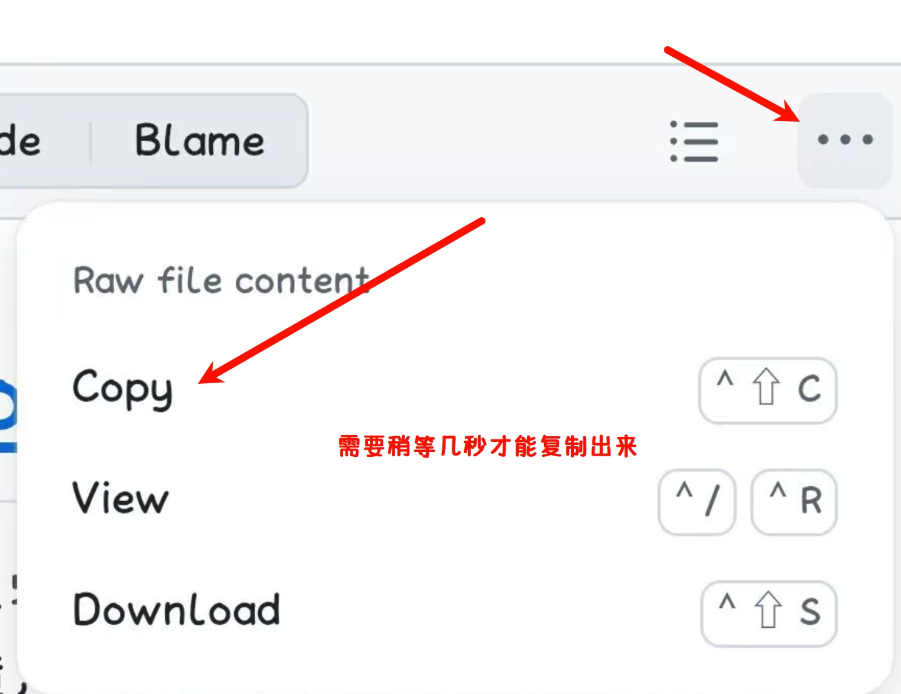
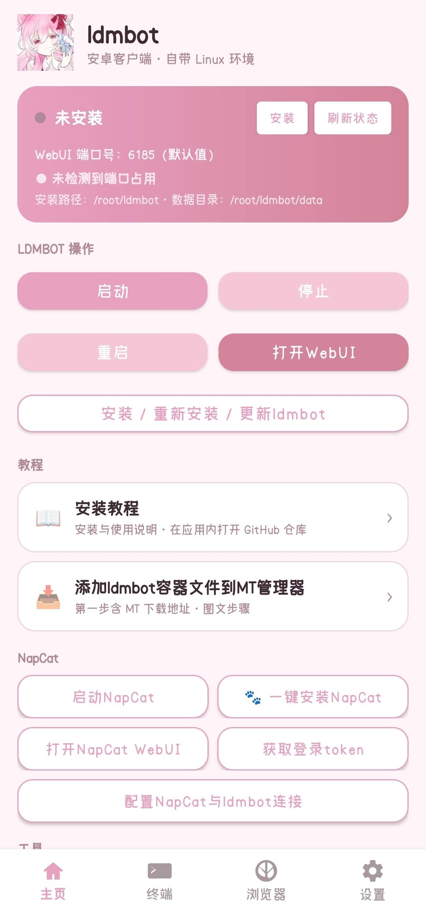
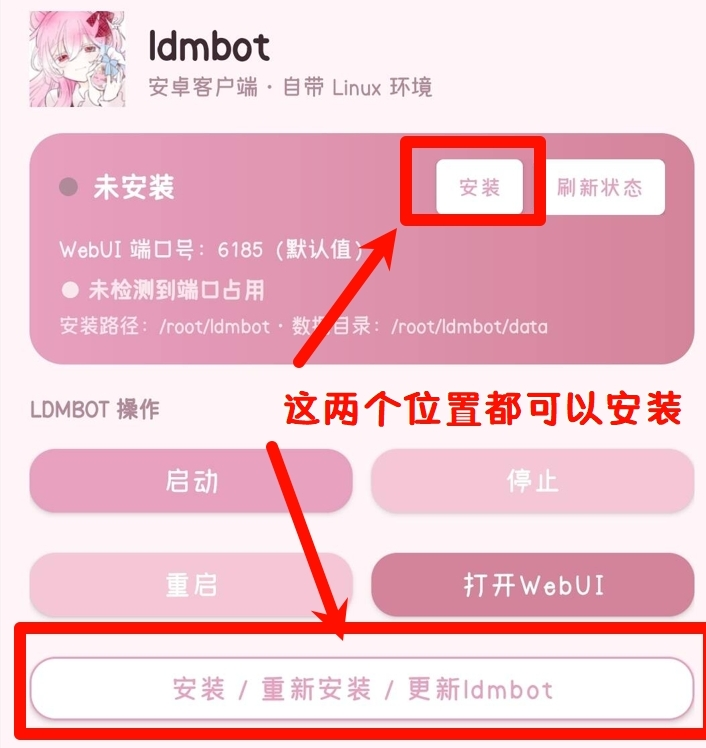
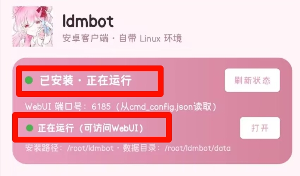
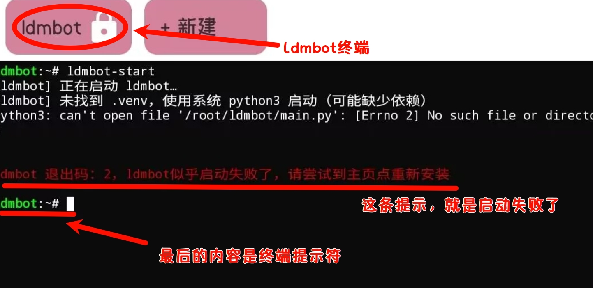
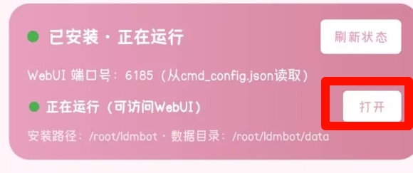
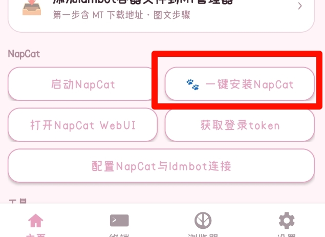
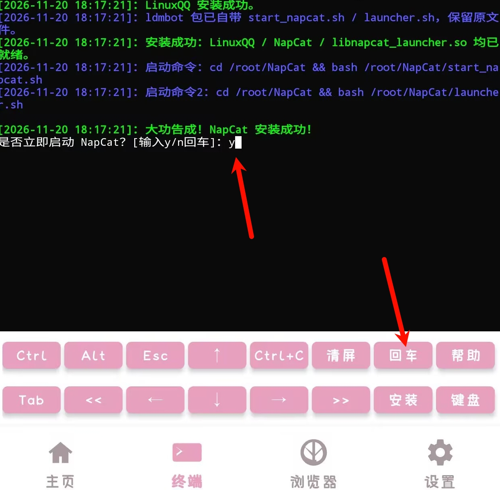

# ldmbot 安装教程（安卓客户端）
**本篇为指导AI编写，如需人话版，可点[人话版](安装教程_自撰版.md)**
> **适用版本**：ldmbot 安卓客户端 2.0.x

**流程**：装 App → 装 ldmbot → 启动 → 登录 WebUI →（个人 QQ 号才需要）装 NapCat 并配置连接。

## 学会求助 AI！！！

学会这一招，后面每一步你都能自己解决，不用等人回。

> **AI 的解答更详细、更专业**——前提是把材料给全。

任何一步和教程不一样，把这四样一起发给 AI：

1. **终端输出**：切到「终端」→ 长按 → 全选 → 复制。太长就复制**最后 30 行**，报错都在末尾。
2. **截图**：当前页面、弹窗、灰掉的按钮都截上，一张图胜过十句描述。
3. **你卡在哪**：做到第几节、点了哪个按钮、本来应该怎样、现在怎样。
4. **这份教程**：让 AI 对照你看到的步骤。在 GitHub 网页打开时，点右上角「…」→「Copy」复制全文（要等几秒才复制得出来）。



开头照抄这句，后面粘终端内容：

> 我在装 ldmbot（版本 __），做到第 __ 节「点了 __」，本来应该 __，但现在 __。终端内容如下：（粘贴）

- 还能再补两样：「设置」→「复制软件信息给 AI」；连不上或不回消息时，附 WebUI「平台日志」截图。
- **别只发截图不打字**，也别只说「装不上」——材料越全，AI 一次就能定位。
- 发之前把 **QQ 号、token、API Key** 打码。

下文每处「卡住了」，都是按这四样发材料。

---

## 一、要装哪些东西

| 你的情况 | 装什么 |
| --- | --- |
| 个人 QQ 号当机器人 | ldmbot + NapCat |
| QQ 官方机器人 / 飞书 / 企业微信 / Telegram 等 | 只装 ldmbot |

NapCat 是让个人 QQ 号收发消息的登录端，跑在同一台手机里，可在 App 里一键安装。

## 二、安装 App

> **如果你是在 App 里看到这份教程的，说明 App 已经装好了**，直接跳到第三节。

1. 下载最新 APK（Android 8.0+、arm64）：<https://github.com/landamao/ldmbot_apk>
2. 打开后等 Linux 环境初始化（几十秒），同意免责声明进主页。



主页从上到下：状态卡（安装 / 运行状态、端口）、LDMBOT 操作、教程、NapCat、工具。按钮是灰的表示当前不可用，先完成前一步。

## 三、安装并启动 ldmbot



1. 点状态卡右侧「安装」，或底部「安装 / 重新安装 / 更新ldmbot」；
2. 弹窗选「**安装**」，等终端跑完；
3. 装完点「启动」。

**安装**＝全新装；**重新安装**＝强制重装（只清源码）；**更新**＝只同步源码。三者都保留 `data`，聊天记录和插件不会丢。

安装期间按钮会变「停止安装」；不要关终端标签，否则会话里的进程会被一起结束。

**成功的标志**：状态卡「已安装 · 正在运行」+「正在运行（可访问WebUI）」，两个绿点。



**失败的样子**：终端红字，最后一行停在提示符。



```text
ldmbot 退出码: 2, ldmbot 似乎启动失败了，请尝试到主页点重新安装
ldmbot:~#
```

处理：回主页选「**重新安装**」→ 再点「启动」。仍失败就按开头的方法，把红字和截图发给 AI，别删文件。

## 四、登录 WebUI

点状态卡「打开」或操作区「打开WebUI」：



- 地址 `127.0.0.1:6185`，端口以状态卡为准（改过也会自动跟随）；
- 账号 `ldm`，密码 `ldm`。

登录后点左上角三条杠展开侧栏。**先去「欢迎」页配 AI 模型**，不配的话机器人不会 AI 聊天，只能回指令类内容。常用页：机器人（消息平台）、模型提供商、ldm插件、配置文件、平台日志（排错看这里）。

> **密码不对？** 去主页「重置WebUI密码」恢复 `ldm / ldm`，重启后再登录。

## 五、安装 NapCat（仅个人 QQ 号）

用官方机器人或其它平台的，跳到第六节。

### 1. 一键安装



点「🐾 一键安装NapCat」→ 确认 → 自动下载执行。看到「大功告成！NapCat 安装成功！」后，输入 `y` 回车立即启动（可用快捷键栏的「回车」）。



> **装不上？** 截图 + 复制终端最后 30 行，按开头四样发 AI，注明「点了一键安装之后」。

### 2. 扫码登录 QQ

点「打开NapCat WebUI」，会自动带上 token 打开 `127.0.0.1:6099/webui`；如果页面仍要求填 token，回主页点「获取登录token」复制过去。进去后用要当机器人的 QQ 扫码登录。

打不开、白屏或没有二维码：先点「启动NapCat」，再点「获取登录token」复制地址，在浏览器里重新打开。

> **这一步必须成功**：没登录过 QQ，下一步的配置一定连不上。

### 3. 配置连接

点「配置NapCat与ldmbot连接」。App 会**先自动停掉 ldmbot 和 NapCat**，再执行配置脚本。

> **同一个 QQ 只配一次**；换号才需要重新配置。

### 4. 重启并验证

1. 主页「启动」→ 等状态卡变绿；
2. 点「启动NapCat」；
3. WebUI「机器人」页确认 NapCat 平台已启用；
4. 用另一个 QQ 私聊机器人 QQ 发消息。

群里使用需要 @ 机器人或触发唤醒词。

> **不回消息？** 按顺序查：QQ 是否在线 → 平台是否启用 →「模型提供商」是否配好 →「平台日志」有没有报错。都正常仍不回，就把各终端标签页截图 + 最后 30 行 + 平台日志截图，按开头四样发给 AI。

### 5. 换了 QQ 号

重新扫码登录新号，再点一次「配置NapCat与ldmbot连接」。

## 六、不装 NapCat

WebUI「机器人」→「+ 新建」→ 选平台 → 按提示填凭据（AppID / Secret / Token）→ 保存并启用。

## 七、日常维护

| 要做什么 | 怎么做 |
| --- | --- |
| 更新 | 已能正常运行时，优先在 WebUI 里更新（能拿到最新版）；主页「更新」只同步源码，可能不是最新版 |
| 备份 | 主页「ldmbot备份管理」 |
| 忘记 WebUI 密码 | 主页「重置WebUI密码」（恢复 `ldm / ldm` 或设新密码） |
| 彻底重来 | 主页「重置ldmbot」（两次确认，可选保留 data） |
| 传文件 | 主页「文件」上传，或用 MT 管理器挂载 |
| 锁屏掉线 | 「设置」开「前台运行（保活）」「关闭电池优化」，必要时开「激进后台保活」 |

> **启动顺序**：ldmbot 和 NapCat 谁先启动都行，但两个都要在运行，机器人才能收发消息。

## 八、常见问题

- **启动失败** → 重新安装；仍失败按开头四样把红字和截图发给 AI。
- **装了却显示「未安装」** → 点「刷新状态」，仍不对就重新安装（data 不丢）。
- **WebUI 打不开** → 状态卡要是「正在运行（可访问WebUI）」，否则服务没起来。
- **密码错** → 重置WebUI密码 → 重启 → 再登录。
- **NapCat 白屏 / 没二维码 / 提示 Network Error** → 确认 NapCat 已启动、端口是 `6099`；再用「获取登录token」重新打开，仍不行就清掉该标签的浏览数据再试。
- **重装丢数据吗** → 不会，安装和更新都保留 `/root/ldmbot/data`。
- **改端口** → 改 `data/cmd_config.json` 的 `dashboard.port`，重启后 App 自动跟随。

## 九、速查

| 项目 | 值 |
| --- | --- |
| 源码 / 数据 | `/root/ldmbot` / `/root/ldmbot/data` |
| WebUI | `127.0.0.1:6185`，`ldm / ldm` |
| NapCat | `/root/NapCat`，WebUI `127.0.0.1:6099/webui` |

---

## 反馈交流

- qq群：1103659691 [点击跳转](https://qm.qq.com/q/c7Nc3Tl1Je)
- telegram：@landamaogroup [点击跳转](https://t.me/landamaogroup)
- 项目地址：<https://github.com/landamao/ldmbot_apk>
