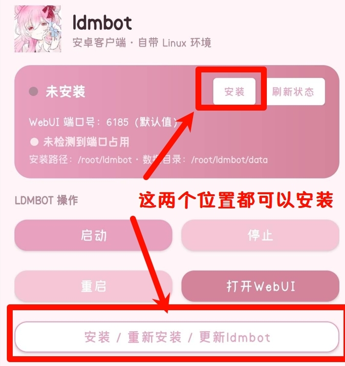
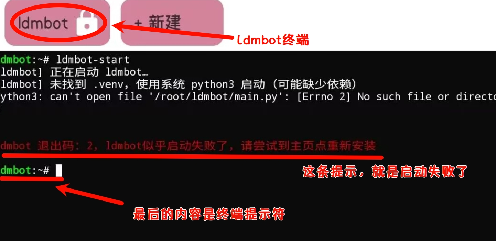
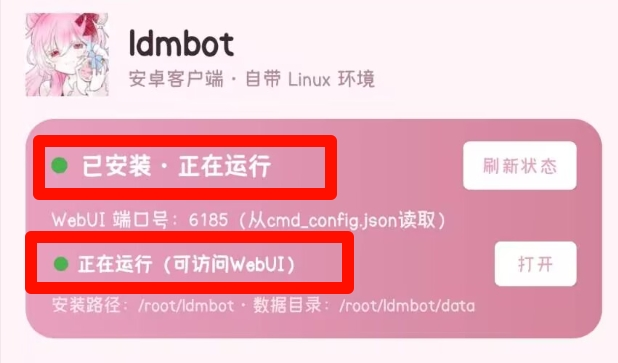
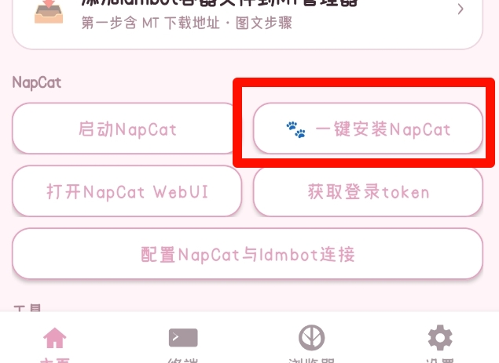
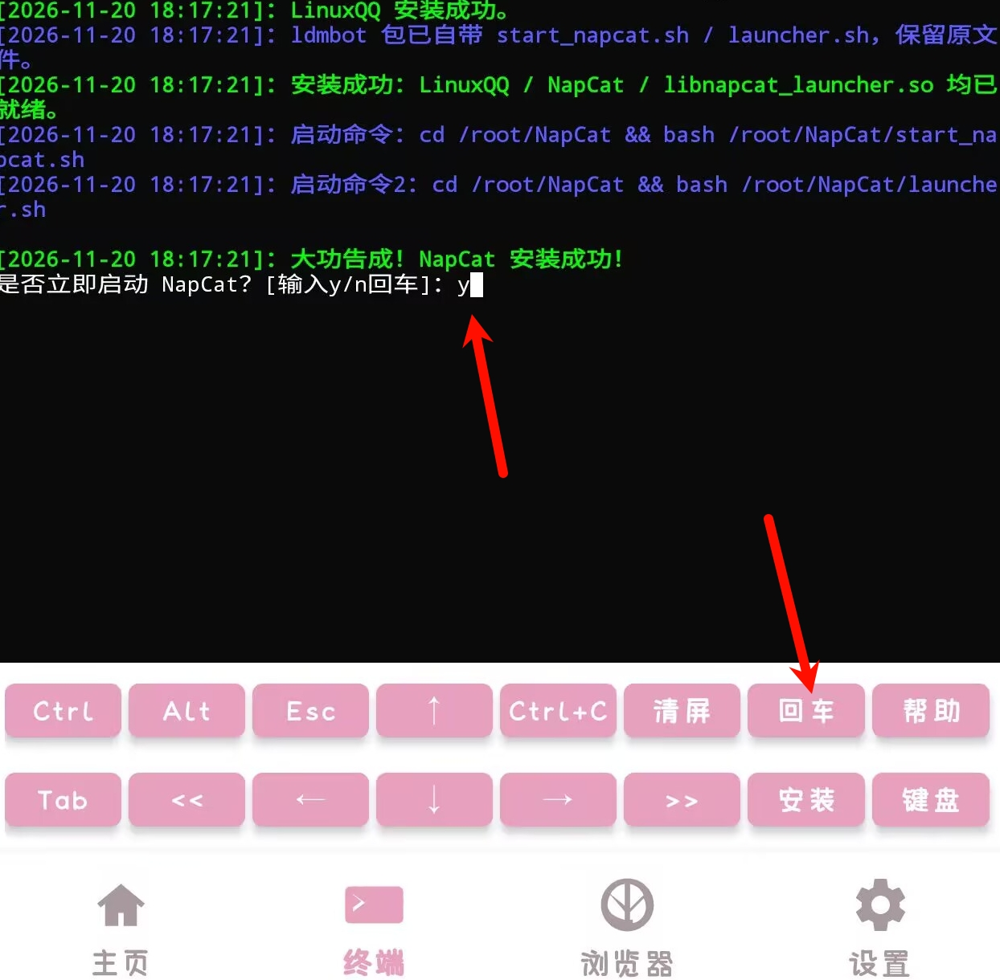

# 安装教程
# 提示：学会求助AI
## 第一步，安装ldmbot

如图：

- 若未安装，随便选择一个安装
- 若已安装，但是启动失败，则选择重新安装

### 什么情况是启动失败
当点击启动后，ldmbot的终端出现了红字，并且最后的内容是提示符，如图：

### 什么情况是启动成功，正在运行
可以查看主页上面的状态，如图：

## 到此，ldmbot的安装差不多已经完成，如遇到困难，可长按选中终端的所有内容，复制粘贴求助AI
## 安装完成后，点击`打开`，打开WebUI，输入账号密码后登录，默认账号密码均为`ldm`

## 登录后可以自己研究配置，点击左上角三条杠打开，切换各个页面，学会求助AI
## 第二步，安装NapCat

### 注意，NapCat是给个人号使用的，如果你使用qq官方bot，或者接入其他平台，则无需安装NapCat

### 安装NapCat

点击一键安装，等待安装完成，安装完成后会提示是否启动，你可选择是否立即启动，输入y并按回车立即启动

### 启动NapCat
启动NapCat后，会弹出二维码，需要使用qq扫码登录，可以点主页的打开`NapCat WebUI`，打开后也有登录界面

## 配置连接

⚠️⚠️⚠️
如果你安装了NapCat，才需要此步骤
# 你必须登录过一次你的qq，才能进行连接配置
登录过NapCat之后，点击主页的`配置NapCat与ldmbot连接`，按提示进行配置，并学会求助AI
若你更换了qq账号，则需要再次点击`配置NapCat与ldmbot连接`进行配置

## 最后，连接到你的qq之后，给你的那个qq私聊发送一条消息，即可收到回复，接下来的配置你需要自行研究摸索，或求助AI，或进群求助懒大猫

## 反馈交流
- qq群：1103659691 [点击跳转](https://qm.qq.com/q/c7Nc3Tl1Je) (https://qm.qq.com/q/c7Nc3Tl1Je)
- telegram：@landamaogroup [点击跳转](https://t.me/landamaogroup) (https://t.me/landamaogroup)
---